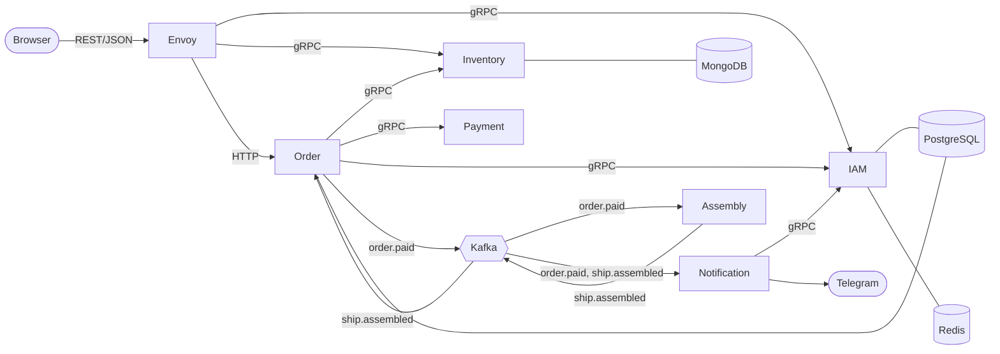

# Aidar Khabibullin

**Senior Full Stack Engineer (Go + React)** with 10+ years building SaaS products in cybersecurity, fintech and e-commerce — from React interfaces to Go microservices and cloud infrastructure.

`Go` · `React` · `TypeScript` · `Next.js (App Router, SSR/RSC)` · `Apache Kafka` · `PostgreSQL` · `Redis` · `gRPC` · `WebSockets` · `Kubernetes` · `AWS` · `Turborepo`

---

## About

Senior Full Stack Engineer and Tech Lead with a backend core: Go microservices, Kafka, PostgreSQL and Redis, built around event-driven architecture and reliable delivery (idempotent consumers, retries, DLQ). On top of that I ship the React, TypeScript and Next.js interfaces, so I can take a feature from the database to the screen.

At ShelterZoom, an enterprise cybersecurity SaaS for document control and e-signatures, I built Go microservices for document processing, notifications, audit and access control, Stripe billing, real-time collaboration, and the CI/CD for 12 services on AWS EKS. I led the full-stack team there as Tech Lead, growing it from 2 to 5 engineers.

I own what I ship in production. In design reviews my first question is which invariant must never break, and what protects it during a failover.

I hold a Master's in Information Security. Based in Istanbul, working in English and Russian.

**Open to:** remote Senior Full Stack / Senior Software Engineer and Tech Lead roles, or hybrid in Istanbul.

---

## Highlights

- 📨 **−50% failed jobs** — 4 Go microservices on Kafka and PostgreSQL with idempotent consumers and a DLQ.
- 💳 **−35% failed transactions** — Stripe payments and subscriptions on Go services with idempotent webhook processing and subscription reconciliation.
- 🚀 **Deployment time from 2 hours to 20 minutes** — CI/CD for 12 Go microservices and all frontend apps on AWS EKS.
- ⚡ **−65% p95 sync latency** in real-time document collaboration (WebSockets, Redis Pub/Sub, optimistic UI on Kubernetes); concurrent editors grew from 5 to 20+.
- 🏗️ **Turborepo monorepo migration** — desktop and mobile apps plus Gmail and Outlook add-ins from one codebase, 1.5× faster delivery.
- 👥 **Team from 2 to 5 engineers** as Tech Lead, with 40% shorter onboarding.

---

## Architecture & Reliability

How I approach backend design: first decide which invariants must never break, then pick the mechanism that protects them.

- **At-least-once delivery, exactly-once effects.** Kafka consumers are idempotent; failures go through retries and a dead-letter queue instead of blocking the partition or being lost.
- **Payments you can trust.** Stripe webhooks are processed idempotently, and subscription state is reconciled against the provider, so duplicates and missed events don't corrupt billing.
- **Auditability.** Signing workflows keep a tamper-evident audit trail, and access control is a separate service with its own boundary.
- **Operability.** Health checks, metrics (Prometheus/Grafana), traces and centralized logs (Kibana), with automated rollbacks in CI/CD.

### Open-source reference: [MSA_Rocket_Factory](https://github.com/aidar-khabibullin/MSA_Rocket_Factory)

My production code is private, so this public Go monorepo shows the same approach end to end: 6 microservices (`order`, `inventory`, `payment`, `iam`, `assembly`, `notification`), gRPC contracts in protobuf/OpenAPI, Kafka events, PostgreSQL / MongoDB / Redis, Envoy as the single entry point (REST/JSON → gRPC), OpenTelemetry tracing with Jaeger, Prometheus and Grafana, and a React + TypeScript frontend.

- **Quality gates in CI:** golangci-lint, unit and integration tests (testcontainers, `-race`), coverage report, `govulncheck`, `gitleaks`, Trivy.
- **Safety by design:** health checks on every service, rate limiting and body-size limits at Envoy, brute-force protection in `iam`, JWT sessions.

---

## Selected Work

### Document Signing & Collaboration Platform · ShelterZoom
`Senior Full Stack Engineer` · `Apr 2021 – Sep 2026` · `Cybersecurity SaaS` · `51–200 employees` · `Remote, New York`

Enterprise cybersecurity SaaS: real-time document control, collaboration and e-signatures.

- Developed an end-to-end signing workflow by integrating Apryse e-signatures with Go and React: multi-party signing orchestration, signer routing and a tamper-evident audit trail for 150+ enterprise customers.
- Optimized real-time collaboration with WebSockets, Redis Pub/Sub and optimistic React UI, scaled across Kubernetes pods: p95 sync latency down ~65%, concurrent editors from 5 to 20+.
- Built and integrated 4 Go microservices on Kafka and PostgreSQL (document processing, notifications, audit, access control); failed jobs down ~50% with idempotent consumers and a DLQ.
- Led the migration to a Turborepo monorepo with shared React/TypeScript packages, shipping desktop and mobile apps plus Gmail and Outlook add-ins from one codebase; optimized CI builds and bundle sizes, speeding up delivery 1.5×.
- Automated CI/CD for 12 Go microservices and all frontend apps on AWS EKS with GitHub Actions, Docker and Helm: parallel tests, layer caching and auto-rollbacks cut deployment time from 2 hours to 20 minutes.
- Scaled a full-stack team from 2 to 5 developers as Tech Lead: code review standards, architecture docs and a buddy system reduced onboarding time by 40%.
- Integrated Stripe payments and subscription management with Go services: idempotent webhook processing and subscription reconciliation reduced failed transactions by 35%.

### Donation Payment Platform · Sberbank (SberVmeste)
`Senior Full Stack Engineer` · `Jan 2020 – Apr 2021` · `Fintech` · `51–200 employees` · `Remote, Moscow`

SberVmeste is a Sberbank charitable donation platform for daily, targeted giving.

- Developed the donation payment system from scratch (React, TypeScript, Node.js): acquiring integration, daily/monthly subscriptions and auto-closing campaigns. Processed 100K+ donations worth $1M+.
- Launched the SberVmeste web app: campaign pages with live progress, a donor account for recurring gifts and a donation calculator. First-time donors +25%.
- Developed a customizable partner portal (React, Redux) with self-service campaign management and reporting for 50+ vetted charities. Support requests −70%.

### Cloud Backup Platform · CloudAlly (now OpenText CloudAlly Backup)
`Frontend Engineer` · `Feb 2018 – Jan 2020` · `Cybersecurity / SaaS` · `11–50 employees` · `Ontario, Canada`

Backup and recovery for cloud applications.

- Developed the React UI for backup and restore workflows: scheduling, point-in-time restore and job status monitoring for Office 365, G Suite and Salesforce data of thousands of business customers.
- Delivered Backup for Salesforce onboarding (React, Salesforce API): OAuth org connection and self-service setup. Customer acquisition +32%.
- Built the MSP Partner Portal (React, REST) with a unified dashboard of accounts, trials, backups and billing, and drill-down to individual backups for 600+ MSP partners.

### Group-Buying Marketplace · Moneta (Runtime LLC)
`Frontend Engineer` · `Oct 2016 – Feb 2018` · `E-commerce` · `11–50 employees` · `Moscow`

- Redesigned catalog and group-purchase pages (React, Redux): product filters, live purchase progress and online checkout. Checkout conversion +33%.
- Optimized performance with webpack code splitting, lazy loading and image optimization: page load time and Time to Interactive −46%.
- Integrated online payments into the group-purchase checkout (React, REST): payment status tracking and order confirmation flows.

---

## 💻 Tech Stack

| **Backend** |         |
| :--- | :--- |
| **Frontend** |        |
| **Data & Messaging** |        |
| **Cloud & Infra** |      |
| **Testing** |       |
| **Observability** |     |
| **AI** |     |
| **Expertise** | Microservices · Event-driven architecture · Distributed systems · System design · Idempotency & reliability patterns (retries, DLQ) · Clean architecture · Technical leadership · Mentoring |

---

## Education

**Master's degree in Information Security and Computer Technologies** — Kazan National Research Technical University named after A. N. Tupolev (KAI), 2008–2014
